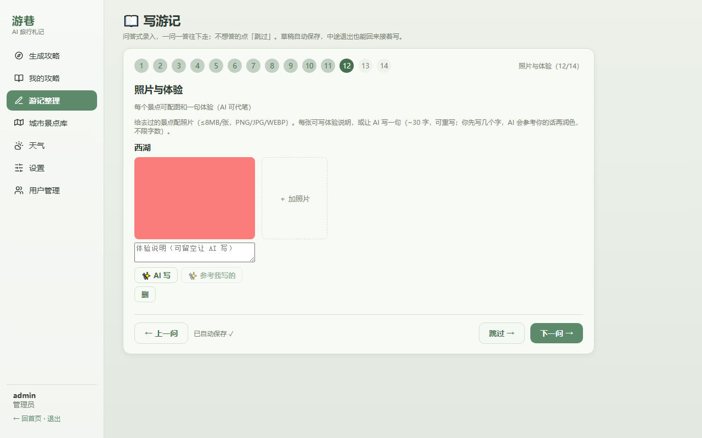
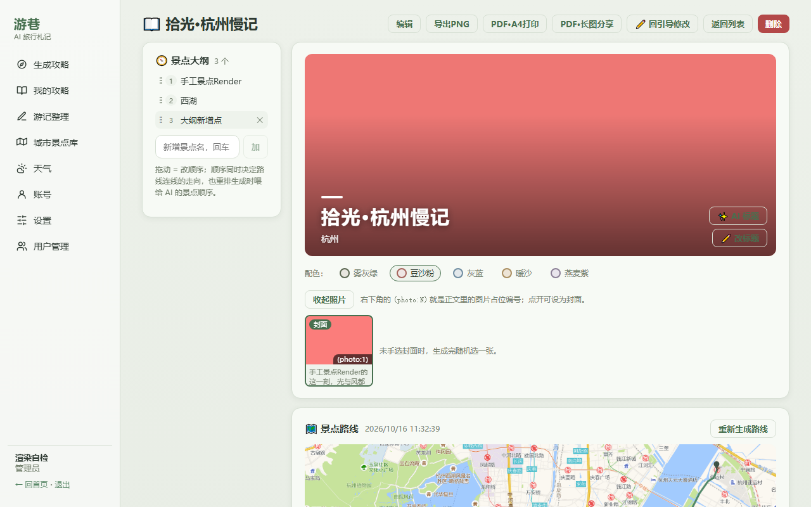
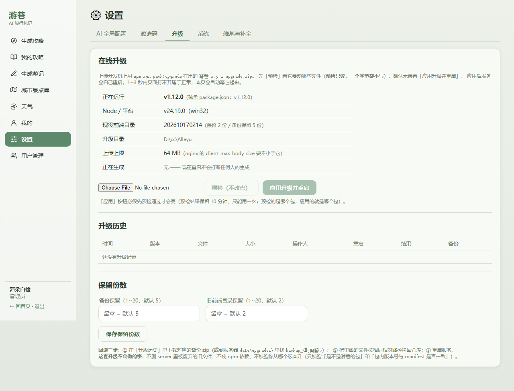
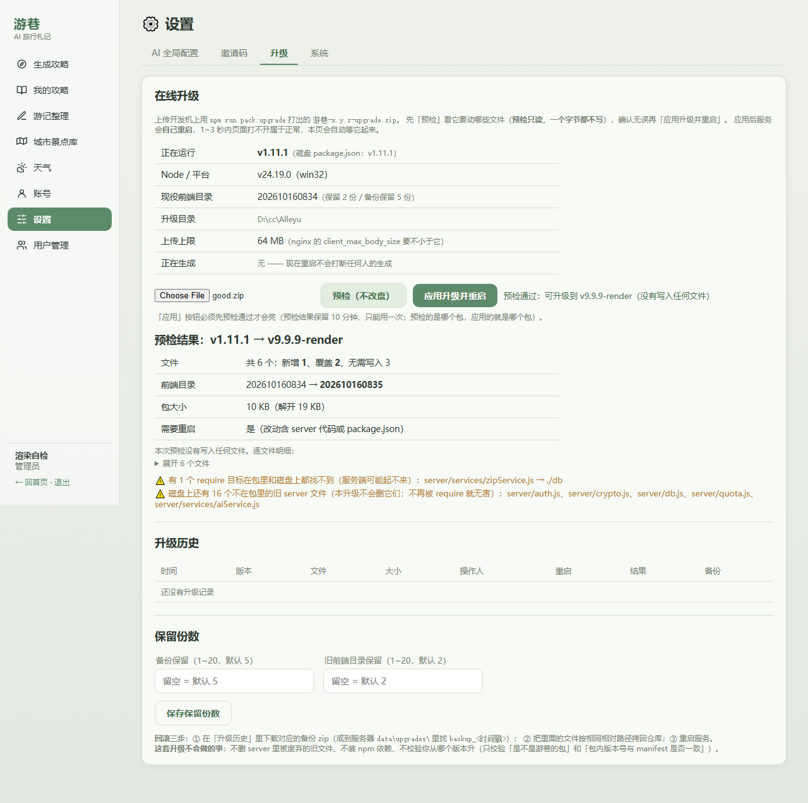

# 游巷 Alleyu

自托管的 AI 旅行攻略生成器：填一张表单，出一篇带地图、照片、天气推演的九模块攻略；玩回来了，用问答式向导把这一趟整理成带照片的游记（PNG 长图 / PDF 分享打印）。多用户、多权限，支持分享链接（动态/静态）与 PDF 导出。











## 它能干什么

- **攻略生成**：按固定九模块框架输出（旅行总览 / 交通指南 / 住宿建议 / 每日详细行程 / 美食清单 / 门票&预约提醒 / 行前准备清单 / 避坑&安全贴士 / 可选拓展），信息落地、不走回头路。生成过程 SSE 流式可见，**进度条 + 阶段说明词 + 3 行实时内容小窗**（进度条下面直接看模型正在返回的正文尾巴，不猜），AI 返回空内容或明显过短（按天数定字数下限）时服务端自动重试 3 次，不再把红字错误甩给用户；失败/不满意的攻略在「复制全文」旁有**重新生成**按钮，原参数原地重跑。生成请求默认**关闭思考链**（`thinking: disabled`）：推理型模型（如 deepseek-flash）会把 max_tokens 预算全吃进思考链导致正文极短甚至为空，实测关掉才稳。
- **游记整理（v1.9.0）**：玩回来的事后记录。「我的攻略」下方新增模块，首页「做攻略」旁多一个「写游记」。**问答式向导**：目的地（城市库联想）→ 出发地 → 天数（只选天数不选日期）→ 人数 → 出发交通 → 当地出行 → 旅行偏好（多选）→ 总费用 → 住宿档次 → 季节 → 所到景点（城市景点库备选勾选，库里没有的**边录边搜**、搜不到就按你写的名字加）——除目的地外每一步都能「跳过」，草稿自动保存，中途退出回来接着写。**照片页按景点分组**：景点之间可**拖动或 ↑↓ 换序**（无色按钮）、可随手**插入新景点**并给它单独加图；每张照片的编号 `(photo:1)` 就是正文里的配图占位编号，照片本身也能拖动改顺序；每个景点名后留一个**「体会」输入框**，写几句心里话，AI 生成时会融进这一段。生成前选**是否合并你的城市攻略**：合并=游记里带攻略的实用信息（文末附速查），不合并=纯旅行记录。**成稿可二次编辑**（Markdown 原文，图片占位保留、导出时自动换回真图），编辑**自动保存**，并留三套文本：**实时版**（正在编辑的这份）、**手动版**（点【保存一版】留档，可【恢复一版】）、**系统原版**（AI 第一次生成的那份，可【恢复原版】）。**左侧大纲**：景点列表可拖动排序、手输新增、单个移除——顺序就是喂给 AI 的分节顺序，也是路线连线的顺序。**封面**：任选一张照片当封面（不选随机），AI 参考 目的地/偏好/季节 起 ≤20 字文学短标题压在封面图上，下方副标题带出行基础信息；标题可手改可 AI 重起；封面下方的照片条**默认折叠**，点开才铺图，每张右下角标着自己的 `(photo:N)`。**景点路线图**：≥2 个景点就按大纲顺序把坐标连成线（高德驾车路径，失败退化为直连折线），出图画在标题下方，配一行文字摘要（站点顺序 + 全程公里数 + 有没有点没定位到）。**导出三件**：PNG 长图（浏览器 canvas 渲染，5 套莫兰迪配色可选，竖版照片按原比例缩放不拉伸）、PDF·A4（分页带页码，打印用）、PDF·长图（单页不分页，网络分享用）——配色贯穿 封面/正文/PNG/PDF。**成稿后的右上角是【回引导修改】**（回问答向导，填好的内容都留着，改完再走一遍重新生成），不是原地重跑提示词。
- **游客模式（v1.8.0）**：首页就是门面——不登录也能看（骑车的兔子一直在），右上角「登录」按钮进登录页；登录页左 2/3 骑车动画 + 右 1/3 登录框。游客能浏览首页，调不了 AI 生成、写不了游记（点了会引导登录），高德地图等接口一律要登录。
- **HTTP 站点上的复制与分享链接（v1.10.2）**：「生成分享链接」「复制」这类按钮以前直接用浏览器的 `navigator.clipboard`，而这个 API **只在 https 或 localhost 下存在**——本站是裸 HTTP（`http://alleyu.in1912.cn`），那里 `navigator.clipboard` 是 `undefined`，一点就抛 `Cannot read properties of undefined (reading 'writeText')`（「生成分享链接」把它当普通错误弹出来，「复制」按钮则干脆没反应——异常没人接）。现在全站统一走 `web/src/clipboard.js` 的 `copyText()`：能用异步剪贴板就用，**不能用就回落到隐藏 textarea + `document.execCommand('copy')`**（HTTP 页面上照旧管用）；真失败了也只会说人话（「浏览器不允许自动复制，请手动选中内容后复制」），不再甩英文异常。分享对话框里那行链接**点一下就全选**、旁边多了个「打开」按钮，手动复制与验证链接是否通都不用绕。另加**「设置 → 系统 → 公开访问地址」**（v1.10.2）：填死域名（如 `http://alleyu.in1912.cn`）后，分享链接一律照它拼——否则你从局域网 IP 或 localhost 打开后台时，复制出去的链接别人打不开；**留空 = 跟随当前地址栏**，改动只影响之后新复制的链接（链接本体是 token，不受影响）。
- **备案号与品牌细节（v1.10.1）**：首页、登录页、注册页**底部都挂 ICP 备案号**，点开新窗口跳工信部 `beian.miit.gov.cn`。要换成你自己的备案号，改 `web/src/views/` 下的 `HomeView.vue` / `LoginView.vue` / `RegisterView.vue` 三个文件里的 `.beian` 那一行即可。字号 12px、颜色用页面自己的灰绿 `--mut`——三个页面都是浅灰绿底，**纯白小字在这个底色上对比度约 1.05:1，肉眼基本看不见**，所以没照字面用白色。默认管理员账号名由 `admin` 改成 **`wpqadmin`**（老库改名要自己执行 `UPDATE users SET username='wpqadmin' WHERE username='admin'`，代码里只在空库首启时创建）。骑车小兔的**车架改成浅粉**（`#f472b6`；车轮的黑胎、白圈、辐条，草编花篮，灰色的链条/脚踏/牙盘/车把，兔子本体、小黄帽、马路一律保持原色），小兔**两只眼睛改成一样大**（后眼以前按透视画小一号），首页副标题删掉了「—— 每敲一个字，它就兔跳一下」这一句（兔跳照旧触发，只是不写在页面上）。三个页面共用同一个 `RiderScene.vue`，改一处三页都变。
- **注册与邀请码（v1.10.0）**：首页右上角「登录」旁、登录页登录按钮下方都有「注册」入口，注册页填**邮箱 / 昵称 / 用户名 / 密码 / 邀请码**（五项都必填）。邀请码由管理员在「设置 → 邀请码」生成：可设**每个码能用几次**（设 1 = 一次性码）、可写**备注**（谁用/用途）、可随时**停用**或删除；码是 8 位、字母表去掉了 `0/O/1/I/L` 这些会看错的字符（邀请码是要手抄给别人念的）。**注册恒定要邀请码**，库里没有可用码时注册页直接写「当前未开放注册，请联系管理员获取」，不让人白填五项。占用邀请码是**一条带条件的 UPDATE**（`used_count < max_uses`）包在事务里，并发生成同一个一次性码不会超发，建号失败还会把码退回来。注册成功**即登录**（少一次输入），新用户默认能用攻略 + 游记、默认开通全局 AI。
- **生成配额与用量（v1.10.0）**：管理员在「设置 → 系统」设**系统默认次数**（攻略、游记各一项，留空 = 不限），在「用户管理」可以按人改：跟随系统默认 / 不限次数 / 指定总额，三项任选。次数是**累计总额、用光为止**（不做每月重置），而且**只有真的生成成功才扣一次**——AI 报错、断流、内容过短自动重试都不扣；管理员自己不受次数限制。用户在「生成攻略」和「写游记」的按钮旁能看到自己的**剩余次数**，用完按钮置灰并写清「请联系管理员增加」。同一张表上还记着每个用户的**累计消耗 token**（输入/输出分开，管理员自己也在列表里），来源是服务商回包里的 `usage`（请求带 `stream_options.include_usage`）——**服务商不回 usage 就不记，绝不用字数估算糊一个数**；本地桩模式同样不记，免得自检把数字刷成假的。
- **提示词透明**：每次生成的完整提示词（系统+用户，含景点库/天气上下文）落在攻略最下方「生成来源」之下的默认折叠框里，展开可看全文、一键复制——到底发了什么给模型，交代得清清楚楚。游记同理（生成提示词同样落库可查）。
- **分享链接（v1.6.0）**：攻略页「分享」按钮生成免登录可开的能力链接（32hex token，可撤销）——**动态更新**（你编辑/重新生成攻略，链接内容自动跟随）或**静态快照**（冻结当前内容，之后可手动「刷新快照」）。分享页整页排版、带模式徽标与更新时间，公开接口只回标题/模式/正文/时间，参数与提示词永不出服务端。删攻略自动清掉它的所有分享。
- **编辑与导出**：已完成攻略点「编辑」直接改 Markdown 原文（保存即更新，动态链接跟随）；「导出PDF」在**服务端生成 PDF 文件直接下载**（不弹打印对话框），带封面标题、章节、表格排版和页脚页码，攻略页和分享页都能导（分享页免登录同理）。服务器没找到中文字体时才回落浏览器打印，并把原因说明白。
- **图文并茂**：封面=**偏蓝单色**全程路线地图（全部点位按行程顺序编号、路线连接线串起来，显示层 CSS 压成蓝调、不用随机网图）、总览地图同样带全程连接线、每日驾车路线图、景点实景照片自动插入正文，图不够的地方文字补。**地图视野自适应**：按全部点位+连线的包围盒算缩放（高德静态图没有自动 fit），散开的景点不再被裁出框，尺幅 1000×580。
- **来源交代**：每篇攻略末尾自动附「生成来源」段——AI 模型与接口出处、地图/天气数据来源链接、生成时间；景点介绍引用了维基系条目时附来源致谢（CC BY-SA 4.0）；增强插图失败也照附。
- **天气**：未来 16 天逐日预报 + 近 5 年同月历史统计推演，附规则研判的出行提醒（非官方预警，页面明确标注）。
- **城市 / 景点库**：42 座国内种子城市 + **国际五线**（欧洲 / 中亚 / 东亚 / 北美 / 南美，58 座关键城市与著名景点直接入库，城市挑选对齐参考站 tabiji.ai 的目的地覆盖）。**线路不是写死的**（v1.7.0）：想加「中东线」「非洲线」直接在城市编辑里填新线路名，入库即在两处筛选里出现，城市可随时改挂别的线路。库页景点页签**先选线路再选城市、不选城市=全部景点分页浏览**（默认每页 10 条，10/20/30/50 可切，可前后翻页、按名字搜）。国内景点坐标缺失时自动用高德补齐，管理员可批量从高德 POI 导入。
- **按线路拉取旅游城市（v1.10.1）**：城市页签顶上每个线路一个按钮（`国内` / `欧洲线` / `中亚线` / `东亚线` / `北美线` / `南美线`），按钮上的 `+N` 就是这条线路库里还缺几座内置城市，补全的线路显示 `✓` 并置灰。点一下只把**库里还没有的**城市补进来，已有城市一律跳过、**不改动任何现有数据**（省份/坐标/线路是你可能手改过的），新补进来的城市连带它的种子景点一起入库，不会留一座空壳城市。自建线路（如「中东线」）没有内置种子，按钮会如实回「没有内置种子城市」。景点页签的「🔄 补全全部缺景点城市」同时收窄为**只处理一个景点都没有的国内城市**——已有景点的城市不再被重复拉一遍高德（要给某座城市加量，用「⚡ 一键补全本城市」）。
- **景点介绍补全（v1.7.0）**：景点库每条景点可带**介绍文本**（来源=维基旅行 zh.wikivoyage.org，兜底维基百科，MediaWiki API 免 Key、800 字内节选）；管理员「⚡ 一键补全本城市」= 高德「风景名胜」分类检索批量导入（国内，两页 50 条去重留新）+ 全市缺介绍的景点逐条补维基介绍（上限 40 条/次）；国际线城市没有高德数据，只补介绍。补好的介绍两处生效：景点表格直接看，**生成攻略时进 AI 上下文**（写作时直接引用）；有引用的攻略末尾「生成来源」段自动附**致谢与 CC BY-SA 4.0 署名**。单条景点也有「介」按钮单独补。
- **多租户多权限**：管理员配全站唯一一份全局 AI Key、按人开通 `can_use_ai`、按人收窄可见页面（v1.6.0 起个人 Key 配置下线——两份配置分不清谁的锅）。**v1.10.0 权限收口**：「设置」「用户管理」「城市景点库」是管理员专属——普通用户侧栏与首页都看不到这三个入口，直接敲 `#/settings` 之类的地址会被路由守卫弹回首页，接口层也拦（`canAccess` 里 settings 页对非管理员硬拒）。普通用户多一个**「账号」页**：看自己的用户名/邮箱/角色/注册时间、剩余次数与累计 token，**只能自己改昵称和密码**（用户名是登录凭据不可改）。城市/景点**只读接口仍然登录即可**——攻略表单的目的地联想和游记的「边录边搜」要用它们，写操作照旧有各自的管理员闸门。Key 保存时自动剥掉全部空白字符；裸 32 位十六进制（丢了 `sk-` 前缀）的 Key 测连通 401 时会直接提示「像是粘贴时丢了开头」——服务商报错只回 `****a9f1` 尾巴，人眼根本看不出前缀丢了。
- **在线升级（v1.11.0）**：管理员在「设置 → 升级」上传一个升级包就能升级，不用登服务器、不用 git——**先预检（只读，一个字节都不写）再应用**，应用完服务自己重启、页面等它上线后自动刷新。升级包用 `node scripts/build-upgrade-pack.mjs` 现打（版本号取 `package.json`，内容=整份 `server/` + 一个全新时间戳的 `web/dist/` 目录 + `package.json`，几十万个字节级的小包），包内路径走白名单校验、`data/` 一律拒绝、`server/` 里每个 js 写盘前先编译一遍；被覆盖的文件先备份到 `data/upgrades/backup_<时间戳>/`（可在历史里直接下载），**回滚就是把备份拷回去重启**。详见下方「在线升级」。
- **首页封面**：乳白小兔骑车动画（粉内耳+小黄帽），打一个字跳一下（兔跳特技），场景无天空、直接融入页面背景；侧栏菜单为单色线性图标（跟随文字色），favicon 与生成转圈也是兔子。

## 快速开始

要求 Node ≥ 22.5（用了 `node:sqlite`）。

```bash
npm install            # Windows 慢就加 --registry=https://registry.npmmirror.com
npm start              # 或双击 start.bat；默认 9610 端口
```

打开 http://localhost:9610，默认账号 `wpqadmin / admin123`（**部署后立刻改密码**；这只在**空库第一次启动**时创建，之后改环境变量也不会覆盖已有账号）。

给别人的账号走**邀请码**：用管理员登录 → 「设置 → 邀请码」生成一个码（一次性或可用 N 次，可写备注）→ 把码给对方 → 对方在注册页自己填邮箱/昵称/用户名/密码。库里有可用码时注册页才开放；没有码时页面会直接说「当前未开放注册」。

Docker：

```bash
docker compose up -d
```

前端构建产物已随仓库分发（`web/dist/<时间戳>/`，`.latest` 指当前版），clone 即用；改前端才需要重新构建（见下）。

## 三端分发包

`node scripts/build-dist-packages.mjs` 在仓库根目录产出三个 zip（`*.zip` 已在 .gitignore 里，不入库）：

| 包 | 带什么 | 落地方式 |
|---|---|---|
| `游巷-<版本>-windows.zip` | 运行时 + **生产依赖**（node_modules）+ `start.bat` | 解压双击，Node ≥22.5，不用联网装依赖 |
| `游巷-<版本>-macos.zip` | 同上，启动器换成 `start.command` | 首次 `chmod +x start.command` 再双击 |
| `游巷-<版本>-docker.zip` | 源码 + `Dockerfile` / `docker-compose.yml` / `.dockerignore` | 不带 node_modules，`docker compose up -d --build` 时装 |

三个包一视同仁地抠掉这些东西：`data/`（改成空壳，首启自动建库——库、`.secret`、AI Key、高德 Key、`mapimg/` 都在里面，绝不能进包）、`Logs/`、`img/`、`scripts/`（自检脚本要 playwright，属开发件）、源码 `web/src/`，`web/dist` 只带最新一份。分发版 README 里的配图行会自动摘掉（截图在项目主页看），包内另有一份按端写好的 `部署说明.txt`。压缩走 `scripts/zip-utf8.py` 而不是 tar——`tar`/bsdtar 写 zip 不给中文名打 UTF-8 标志位，Windows 解压出来是乱码。

`start.command` 会先把 Node 版本卡在 22.5：本应用用 Node 内置的 `node:sqlite`，22.4 及以下没有这个模块，起不来。

## 在线升级（管理员）

已经跑起来的站点不用再靠 git 或手工拷文件升级：管理员在「设置 → 升级」上传一个升级包，**先预检、再应用**，应用完服务自己重启。

### 打一个升级包

```bash
node scripts/build-upgrade-pack.mjs        # 或 npm run pack:upgrade
# → 游巷-<版本>-upgrade.zip（仓库根，*.zip 已 gitignore）
```

版本号只有一个来源：`package.json` 的 `version`。想发版先改它，再 `node scripts/build-upgrade-pack.mjs`。包里是**整份 `server/**` + 一个全新时间戳的 `web/dist/<时间戳>/**` + `package.json` + `manifest.json`**——不搞差分，宁可多带几个文件，也不让「前端换了、后端没换」这种半截状态有出现的可能。

脚本自己会拦几种发错包的情况：前端源码比 `dist` 产物新（你会看到「先 `cd web && npm run build`」，真知道自己在干什么可以加 `--force`）、`dist/<时间戳>/index.html` 缺失、`web/dist/.latest` 没指向选中的目录、依赖表与 `HEAD` 的 `package.json` 不一致（依赖变了必须显式加 `--allow-dep-change` 确认）、路径里有非 ASCII 字符。打完还会把包解回来逐条比对 sha256 才落盘，顺手把打包器的 bug 挡在发版前。

### 在界面上升级

「设置 → 升级」：选包 → **预检**（只读，一个字节都不写）→ 看清「新增多少 / 覆盖多少 / 跳过多少」→ **应用升级并重启**。

- **预检是只读的**，这一步会告诉你：包里是什么版本、升到哪个版本、哪些文件是新增/覆盖/内容相同被跳过、哪些会被拒绝（路径越界、不在白名单、`server/` 里的 js 编译不过、前端时间戳不比你线上的新……），以及有没有需要人工处理的依赖变化。**有问题就在这一步停住**——预检不过就不会写盘。
- **应用是「两阶段落盘」**：先全部写成临时文件，再逐个改名就位。所以「包有问题」和「写了一半」不是一个概念：前者零写入，后者才是唯一的半新半旧窗口（Windows 上文件被占用时每个文件重试 3 次，仍失败会停下并把「已生效/未生效清单 + 备份目录」写进日志）。
- **被覆盖的文件会先备份**到 `data/upgrades/backup_<时间戳>/`（保留最近 5 份，可在「升级历史」里直接下载成 zip）。
- **自动重启**：只要包里动了 `server/**` 或 `package.json`，应用完老进程会拉起一个接替进程再退出，页面等它上线（最多 90 秒）后自动刷新。只换了前端的话连重启都不需要——服务端每个静态请求都现读 `web/dist` 下最新的时间戳目录，新目录一落地，下一次请求就是新版。

### 回滚

1. 在「设置 → 升级 → 升级历史」里点那一行的**下载备份**（或直接到服务器 `data/upgrades/backup_<时间戳>/` 拿文件）。
2. 把里面的 `server/**`、`package.json`、`web/dist/.latest` 按原相对路径拷回部署目录覆盖。
3. 重启 `node`。

### 从开发机一条命令推过去

界面上的升级适合「人就在浏览器前」的场景；如果你希望发版时直接从开发机推：

```bash
# 只预检（一个字节都不写）
ALLEYU_ADMIN_USER=<管理员> ALLEYU_ADMIN_PASS=<密码> node scripts/push-upgrade.mjs

# 真升级（预检 → 应用 → 等它自己重启 → 硬验证）
ALLEYU_ADMIN_USER=<管理员> ALLEYU_ADMIN_PASS=<密码> node scripts/push-upgrade.mjs --apply
```

`--pack` 指定包（默认取仓库根最新的 `游巷-*-upgrade.zip`）、`--url` 指定站点（默认 `ALLEYU_URL`，再默认 `http://alleyu.in1912.cn`）、`--allow-dep-change` 放行依赖变化、`--timeout` 改等重启的秒数（默认 120）。凭证**只从环境变量读**，脚本不回显密码与 token；预检不过或包不比现役新（`STALE_DIST`）会当场停下并把服务端的原话打出来。

最后一步是**硬验证**：它不只比版本号，还会拉线上首页、把入口 `assets/index-<hash>.js` 与包内 `index.html` 的入口 chunk 名逐字比对——版本号只能证明 `package.json` 换了，入口 chunk 名才证明**新前端真的在服务**（对不上会明确报错，不当作升级成功）。

### nginx / 排查

- **上传通道**：升级包走的是 `POST /api/upgrade/plan` 的原始二进制体（不是 multipart/表单），反代要放开体大小：`client_max_body_size 64m;`（和 `ALLEYU_UPGRADE_MAX_MB` 同口径）。没放开的话上传会得到 413，页面会直接说「升级包超过上传上限」而不是让你猜。进程本身**不收**表单，也没有引入任何新依赖——zip 编解码是项目自带的小实现。
- **看重启日志**：Windows 上接替进程的 stdout/stderr 全被重定向到 `Logs/restart-child.log`，`Get-Content Logs\restart-child.log -Wait` 能实时看到它有没有起来。如果它起不来（端口占用、`server/` 代码有问题），这次升级的结论在 `Logs/upgrade.log` 里（一行一次，`Get-Content Logs\upgrade.log -Tail 20`），「升级历史」也会有一条失败记录。
- **手动重启不生效？** 如果你把服务放在一个会随控制台一起关闭的窗口里跑（`start.bat` 双击那种），接替进程可能被一起带走。长期跑建议注册成服务（nssm / winsrv），README 的「诚实的边界」里写了这一点。
- `ALLEYU_NO_RESTART=1`：只写文件、不重启（自检用它，日常别开）。开了以后升级结果会**黄字如实告诉你「文件已落盘但进程没重启」**，不会假装升级完成。

## 配置

| 环境变量 | 默认 | 说明 |
|---|---|---|
| `PORT` | 9610 | 监听端口 |
| `DATA_DIR` | 项目下 `data/` | 数据库、密钥、地图图片缓存都在这 |
| `DEFAULT_ADMIN` / `DEFAULT_ADMIN_PASSWORD` | wpqadmin / admin123 | 仅空库首次启动生效 |
| `ALLEYU_AI_STUB` | — | 历史开关，现在只影响设置页显示标记。桩 AI 是「未配置任何 Key 时的兜底」：个人或全局配了 Key 一律走真接口，不会被它盖掉 |
| `ALLEYU_AI_FORCE_STUB` | — | **测试用真强制桩**：无视一切已配 Key 强制走本地桩（render 自检靠它拿到确定性；日常运行别开） |
| `ALLEYU_PDF_FONT` | 自动探测 | PDF 导出的中文字体绝对路径（单文件 .ttf/.otf；探测顺序=data/fonts/ → Windows 等线/黑体 → Linux 思源黑体；**.ttc 集合不支持**） |
| `ALLEYU_WIKI_OFFLINE` | — | 置 1 时维基介绍抓取直接报错（离线自检防偷跑真网用；日常运行别开） |
| `ALLEYU_UPGRADE_MAX_MB` | 64 | 在线升级的包体上限（与反代的 `client_max_body_size` 同口径，改要一起改） |
| `ALLEYU_NO_RESTART` | — | 置 1 时升级只写文件不起接替进程（自检用；结果会如实说「没重启」） |
| `ALLEYU_UPGRADE_ROOT` / `ALLEYU_WEB_ROOT` | 项目根 / `web/` | 升级落盘的根目录与前端根目录。**自检靠它把升级指到临时副本上**，正常部署不用设 |

运行后配置（界面「设置」页）：

- **AI（管理员全局，全站唯一一份）**：OpenAI 兼容 `base_url + model + key`，开通 `can_use_ai` 的用户都用它。Key 落库前 AES-256-GCM 加密、自动剥掉粘贴带进的空白；接口只回 `has_key` 布尔，永不明文出服务端。
- **高德 Key**：自备——到 lbs.amap.com 申请**「Web服务」类型**的 Key（免费），部署后在「设置」页填入保存。「Web端(JS API)」类型调不了 REST 接口（infocode 10009）。Key 只在服务端使用，不下发浏览器。先点「测试连通」，报错会给人话原因（配额/IP 白名单/类型不匹配）。v1.6.3 起不内置任何默认 Key。
- **邀请码**（v1.10.0，「设置 → 邀请码」）：生成时选个数（一次最多 50 个）与每个可用次数，设 1 就是一次性码；可写备注。已用过的码建议点「停用」而不是删除——备注里写着「谁邀请的谁」，删了就断线索了。库里没有「启用且没用完」的码时，注册整体关闭。
- **公开访问地址**（v1.10.2，「设置 → 系统」）：拼分享链接用的域名，例如 `http://alleyu.in1912.cn`；**留空 = 跟随你当前地址栏**。你从局域网 IP 或 localhost 打开后台时填上它，复制出去的链接别人才打得开；只影响之后新复制的链接。
- **默认生成次数**（v1.10.0，「设置 → 系统」）：攻略、游记各一个数字，**留空 = 不限**。只对「新用户」和把配额设成「跟随系统默认」的用户生效；单独给人加次数在「用户管理」里改（跟随默认 / 不限 / 指定总额三态）。管理员自己不受限。
- **升级保留份数**（v1.11.0，「设置 → 系统」）：备份目录保留几份（默认 5）、`web/dist` 保留几份（默认 2）。备份每次升级一份，删掉最旧的；`dist` 目录名是时间戳，攒着只会白占磁盘（旧目录本来也没人请求），留 2 份够回滚。

## 架构

```
server/                 Express + node:sqlite（单库，guides 按 user_id 隔离）
  auth.js               会话、页面权限白名单（非管理员 allowed_pages 空 = 攻略+天气；
                        设置页硬拒；城市/景点读接口只要求登录）
  quota.js              v1.10.0 生成配额：额度解析（-1 跟随默认 / -2 不限 / N 总额）、
                        闸门 checkQuota、成功才扣的 consumeQuota
  crypto.js             AES-256-GCM（enc:v1:iv:tag:data），密钥在 data/.secret
  routes/               auth/users/invite/ai/city/guide/journal/share/amap/weather/settings/upgrade
  services/
    zipService.js       v1.11.0 零依赖 zip 编解码（只 require node:zlib；不解压执行任何东西，
                        只为升级包服务——不引入 multer/adm-zip）
    upgradeService.js   v1.11.0 在线升级：预检（只读：路径白名单/manifest/sha256/vm.Script 语法）
                        → 两阶段落盘（tmp 全写 → 逐个 rename）→ 备份与日志
    restartService.js   v1.11.0 Windows 自我接替：detached 子进程抢端口（stdio 全重定向到
                        Logs/restart-child.log），state.json 记交接状态
    aiService.js        全局 Key 解析（v1.6.0 起全站唯一一份）、SSE 流式对话、桩模式、
                        v1.10.0 取服务商回包 usage（stream_options.include_usage）走 onUsage 回调
    usageService.js     v1.10.0 累计 token 记账（users.tokens_in/out 累加，桩模式不记）
    pdfService.js       v1.6.1 服务端 PDF（中文字体探测 + marked→pdfkit 排版）；
                        renderJournalPdf（v1.8.0 游记：封面压图+莫兰迪配色，A4 分页/长图单页两模式）
    guideService.js     九模块框架模板、生成主流程、插图管线
    journalService.js   v1.8.0 游记：问答 meta→提示词、配文/标题小调用、生成管线（与攻略同构）；
                        v1.9.0 加 buildRoute（景点坐标→高德连线→静态图+文字摘要，结果缓存进 route_json）
    amapService.js      POI 检索/地理编码/静态地图，全局 350ms 串行节流
    wikiService.js      维基旅行→维基百科介绍抓取（MediaWiki API 免 Key，200ms 串行节流）
    weatherService.js   Open-Meteo 预报+历史归档，免 Key
web/                    Vue 3 + Vite（hash 路由）+ marked
  src/views/            首页(兔子场景+游客模式)/登录(左动画右登录框)/注册(邀请码)/表单/攻略/历史/
                        游记列表/游记向导(14 步问答)/游记详情/城市景点库/天气/设置(含邀请码、升级)/用户管理/
                        账号(普通用户改昵称密码)/分享页
  src/stores/session.js v1.10.0 共享登录态单例：路由守卫、侧栏、首页快捷入口读同一份角色/权限
  src/journalPng.js     游记 PNG 长图（浏览器 canvas 两遍渲染：先量高再整图绘制）
  src/journalPalettes.js 莫兰迪 5 套配色（与 pdfService.PALETTES 同值，两端各存一份）
  src/md.js             markdown 展示清洗（攻略页与分享页共用）
  dist/<时间戳>/         构建产物随仓库分发，.latest 标记当前版
scripts/
  check-alleyu.mjs        API 自检（--online 加真实外网断言）
  render-alleyu.mjs       Playwright 渲染自检 + 截图
  build-upgrade-pack.mjs  打在线升级包（版本号取 package.json）
  push-upgrade.mjs        从开发机把包推到在跑的站点（凭证只走环境变量；末尾比入口 chunk 硬验证）
  verify-upgrade-restart.mjs 「升级→自动重启→新版本真在跑」的真机演练（会真起进程，只杀自己的）
```

几个值得知道的设计决定：

- **SSE 是查库不是转发的**：生成写库（节流 ~600ms），`GET /guides/:id/stream` 每 400ms 轮询推送。内容协议是「基线快照式」：正文追加推 `delta` 增量，内容被改写（配图阶段会在顶部前插封面地图）或断线重连则推 `reset` 全文快照——不会丢封面也不会重复中段。阶段变化推 `stage` 事件（进度条数据源）。游记 `GET /journals/:id/stream` 同一套协议。
- **游记照片走 base64 JSON 上传**：`POST /journals/:id/photos` 收 dataURL，route 级 40mb 解析器 + 全局 12mb JSON 上限（8MB 照片 base64 后 ~10.7mb，限太低会在到达 route 校验前被 413 掐掉）；magic byte 校验扩展名、8MB/张按解码后真实字节数卡；原图落 `data/journal_photos/<游记id>/`，`` 走 query token 直链。正文里的配图是 `` 占位（N=照片 sort），前端渲染与 PDF 导出各自换成真图——删了照片不炸，退化为文字说明。
- **游记按用户隔离**（同攻略）：他人 404，管理员也读不到；配文/标题/生成三个 AI 动作要 `can_use_ai`，草稿与手写配文登录即可。
- **游记的三套文本各占一列**（v1.9.0）：`content`=实时版（编辑时自动保存的那份，永远是当前正文）、`content_manual`=手动版（点【保存一版】把实时版拷进来）、`content_original`=系统原版（**只在这一篇第一次生成成功时写一次**，之后重新生成不覆盖它）。详情接口只回「有没有 + 多少字」，全文要恢复时才从 `/content/restore` 取——两套备份正文几十 KB，不该每开一次页面都背一遍。自动保存走既有的 `PUT /journals/:id`（带防抖），不另开接口。
- **照片 `sort` 就是正文里的 `photo:N`**（v1.9.0）：`PUT /journals/:id/photos/order` 收到的是「本篇全部照片 id 的一个不重不漏排列」，校验通过后按新顺序重编 1..N——**没有「只改某一张」的语义**，因为编号是位置而不是身份。所以改顺序 = 编号整体重排，正文里的 `photo:2` 会指向换位后的第二张（这是设计，不是 bug；先排好顺序再生成最省事）。同理照片删了，正文里那个占位会退化成文字说明而不是裂图。
- **路线图结果连失败一起缓存**：`journals.route_json` 存 `{ok,url,summary,points,km,by_road,reason,at}`——成功和失败都写。前端开页面只在「没有缓存」时自动算一次，不然每刷新一次都要打高德；改景点顺序或手动点【重新生成路线】才强制重算。定位用的是「attraction_id → 同城市同名景点 → 高德 POI 现场检索」，**现场检索不写库**（宁可这次画不出来，也不把猜错的坐标写进景点库）。
- **分享是能力链接不是会话**：`shares` 表存 32hex token（`crypto.randomBytes(16)`），公开读端点 `GET /api/share/:token` 在鉴权中间件的 EXEMPT 名单里（免登录），但响应只有 title/mode/content/updated_at 四个字段——prompt、params、images 元数据永不下发。动态模式每次打开现读攻略原文（攻略被删或正在重生成时返回 404 提示「稍后再试」），静态模式读创建/刷新时的快照。SQLite 默认不强制外键，删攻略时代码里手动清 shares。
- **图片管线**：静态地图 PNG 按 sha1 缓存在 `data/mapimg/`，免登录直链 `/api/amap/mapimg/<key>.png`；景点照片走 `/api/amap/photo?u=` 代理，域名白名单只有高德系。每个插图步骤独立 try/catch，图挂了文字攻略不受影响。点位识别以城市景点库为主；**库外城市（如青岛）自动用高德「景点」检索兜底当库**（真名+坐标+照片一次到位，必去景点优先，前缀模糊匹配正文短名）。静态地图 markers 上限 9 个（超出高德报 20003）。
- **配额扣在「真出稿」那一行**（v1.10.0）：`guideService.run()` / `journalService.run()` 从头到尾只有**一处**写 `status='done'`，扣次数就挂在那行后面——所以「内容过短自动重试 3 次后终于成功」只算 1 次，报错/断流一次都不算。库里只记「已用」不记「剩余」（剩余永远现算），管理员改额度立即生效、不用回填存量。配额闸门放在 404/409 检查**之后**：拿别人的攻略 id 来试，先撞到「不存在」而不是误导人的「次数已用完」。条件 UPDATE（`WHERE used < limit`）保证并发下最多超发 1 次。
- **token 记账绝不估算**（v1.10.0）：请求体带 `stream_options.include_usage`，从 SSE 最后一拍（`choices` 为空、带 `usage`）取 `prompt_tokens`/`completion_tokens` 累加进 `users.tokens_in/out`；**服务商不回 usage 就什么都不记**，桩模式（`source==='stub'`）也不记——宁可数字偏小，也不要一个看起来精确、其实是按字数猜的假数。AI 配文/AI 标题这类小调用同样计入 token，但**不扣生成次数**（次数是给「出一篇成稿」用的）。
- **升级包只带整份代码、不带数据**（v1.11.0）：服务端对包内路径做**段级 + 前缀白名单**双重校验，`data/`（库、`.secret`、AI Key、高德 Key、`mapimg/`）直接点名拒绝，`node_modules/`、`web/src/`、`scripts/` 一律拒绝，路径不许有反斜杠/盘符/绝对路径/`..`/非 ASCII。包里的 `server/**/*.js` 会在**写盘之前**用 `vm.Script` 编译一遍（编译但不执行），任何一个编译不过就整体拒绝、一个字节都不写。前端的时间戳目录必须比现役新，否则 `latestDist()` 根本不会选中它——白升一次不如当场报错。
- **重启是「老的先退、新的抢端口」**（v1.11.0）：Windows 没有 `SO_REUSEPORT`，两个进程没法同时 listen 同一个端口，所以接替进程只能在老进程退出后重试（500ms × 24 次）。接替进程是 detached 的，**三个 stdio 全部重定向到 `Logs/restart-child.log`**——这是它能活过父进程控制台的前提。交接状态写在 `data/upgrades/state.json`：发起时置 `restart_pending`，新进程 listen 成功才清掉并记 `handoff_at`；所以「上次升级到底有没有接上班」是可查的（手工重启起来的进程看到 pending 还在会明确警告，接替进程自己看到不会误报——它本来就是来交接的）。
- **攻略私有**：guides 只归本人，管理员也读不到别人的（用户管理页能看到的只有账号信息）；编辑、分享管理同样仅本人。
- **城市/景点库是全局共享的**：所有用户共用一份库，普通用户可以补录景点与介绍（删除/批量导入/一键补全/按线路拉取城市仅管理员）；维基介绍带着 `intro_source`/`intro_url` 落库——CC BY-SA 署名跟随文本，手改介绍默认沿用原条目来源。

## 重新构建前端

```bash
cd web && npm install && npm run build
```

产物进 `web/dist/<新时间戳>/` 并更新 `.latest`，服务端下次请求自动用新版。

## 自检

```bash
node scripts/check-alleyu.mjs            # 离线桩模式，366 项（含 SSE 直播流/分享/编辑/PDF 导出/景点分页/动态线路/游记全链路：CRUD/照片 magic byte/AI 配文/生成 SSE/标题封面/双色 PDF/三套文本/照片排序/景点体会/路线降级/权限/邀请码与注册/生成配额/token 记账/在线升级：zip 纯函数与预检的只读性），起独立临时数据目录与临时仓库副本，不碰真实数据
node scripts/check-alleyu.mjs --online   # 追加 4 项真实外网（高德 POI / Key 连通测试 / Open-Meteo），消耗少量配额
node scripts/render-alleyu.mjs           # 渲染+截图，205 项，自起确定性桩服务器（独占 9610；设 ALLEYU_URL 可打外部已运行服务；playwright 已是 devDependency，clone 后 npm install 即可用）
node scripts/verify-upgrade-restart.mjs  # 升级链路真机演练，23 项：造一个「旧版部署」目录（自带旧 dist/旧版本号/带标记的旧代码）→ 用它自己的空库起服务 → 上传真包 → 预检 → 应用 → 断言它自己重启起来、新前端与新代码真的在跑、备份可回滚，然后按 pid 收掉接替进程、删掉演练目录
```

`verify-upgrade-restart.mjs` 单独存在，是因为「detached 子进程到底能不能在 Windows 上接管端口」这件事，另外两个自检结构上覆盖不到：`check` 全程带 `ALLEYU_NO_RESTART=1`（它跑在仓库上，不能让进程真被换掉），`render` 更是只预检、绝不点应用。它需要先有升级包（`npm run pack:upgrade`），**会真起进程也会真杀进程，但只杀自己拉起来的那个 pid**——绝不用 `taskkill /IM node.exe`。

渲染自检要登录管理员，但**它不碰你的管理员账号**，也不需要你告诉它密码：脚本自己建一个 `render_admin` 账号（密码写死在脚本里）登录，进程退出时（含中途报错）删掉它连同它的会话。原因是真实库里管理员的密码是**你自己的**——你随时会在「账号」页改掉，一改自检就红在第一步。你只需要保证跑之前 9610 端口没有被别的服务占着。它仍会往真实库里造一篇测试游记、一个邀请码和一个注册用户（都在段末清理，崩溃时可能留残留，自己删一下）。

## 诚实的边界

- 天气「预警」是**规则研判**（对预报/历史统计跑阈值），不是气象台官方预警，页面写明了。
- 历史天气是多年同月**统计推演**，用来判断"3 月去昆明大概什么温度"，不是气候保证。
- 高德免费 Key 3 QPS：一篇多日攻略的配图（地图+照片十几次调用）串行下来要半分钟上下，插图在正文之后异步补，等图是正常的。
- 生成进度条的百分比是**诚实估算**不是精确值：写正文阶段按「已生成字数 / 按天数估的字数」走，其余阶段到位即定格、斜纹动画表示进行中；没到 100% 是设计（配图串行耗时不定），不是卡住。
- 封面地图的「偏蓝单色」是显示层做的：存的是蓝墨标记+连线的静态图，前端 CSS `sepia+hue-rotate` 压成蓝调（不是黑白），不做服务端图像处理；路线连接线优先真实驾车路线，高德失败时退化为点位直连折线（保证一定有线）。地图缩放由 `mapFit.fitView` 按包围盒纯函数计算（Web 墨卡托米/像素换算），视野不足时宁可缩到城市级也不裁点。
- **国际线路没有地图配图**：高德静态地图实测没有海外底图（缩到世界级也只渲染中国区域），所以国际线攻略不插路线图与实景照片、正文会注明一行；天气推演（Open-Meteo 全球可用）与文字攻略、生成来源页脚照常。国际景点门票为「约」参考值，库页可改。同理**高德没有海外 POI**——国际线城市的「一键补全」只补维基介绍，不导景点。
- **维基介绍有就有、没有就没有**：抓的是维基旅行/维基百科对应条目首段节选（≤800 字），小众景点没条目返回 miss（不算错误）；介绍文本是**写作参考**不是权威导览，署名与条目链接存在景点库里，攻略引用了就附 CC BY-SA 致谢。维基是境外站点，网络不通时补全会把失败原因写在结果里，不炸。
- 没配 AI Key 时走本地桩（模板造的假数据，只用来验证管线，别拿它出行）；配了 Key 一律走真接口。旧攻略里残留的桩提示横幅在展示时会自动剥掉，正文只从第一个框架标题开始显示——AI 废话前言不展示、复制也不带走。
- **导出 PDF 需要服务器上有中文字体**（pdfkit 单文件 .ttf/.otf 渲染，**.ttc 集合不支持**——Windows 自动用系统等线/黑体，Docker/Linux 里请把任一中文 .ttf/.otf 放进 `data/fonts/` 或设 `ALLEYU_PDF_FONT` 指向绝对路径；没有字体时端点回 400，页面问一句后回落浏览器打印）。PDF 里的图片按原尺寸等比缩放进版心（仅 PNG/JPEG，外链 15s 超时、单图失败不拦整份），排版由 marked 词法树 + pdfkit 逐块绘制，不是浏览器截屏。复制全文按钮给的是 markdown 源码。游记 PDF 同一套字体与排版管线；「长图」PDF 是**单页不分页**（两遍渲染先量高再出真页，受 PDF 页高上限约束，超长内容会被拒），真无限长图用「导出 PNG」（浏览器 canvas，上限 32k 像素，图片太多会明确报错而不是出半截）。
- **游记 PNG 在浏览器渲染、PDF 在服务端渲染**：两端各存一份莫兰迪配色常量（`web/src/journalPalettes.js` 与 `pdfService.PALETTES`，注释里互相指着对方），改配色要两边同步改——服务端 require 不了前端模块，这是取舍不是偷懒。
- **游记路线图不是万能**：要 ≥2 个**能定位到坐标**的景点才连得成线（坐标取自景点库，库里没有就现查高德 POI；没配高德 Key 时查不到）。不满足条件时页面**把原因写在路线卡里**（「至少要 2 个景点」「没能定位到景点坐标」「国际线路——高德没有海外底图」），不是留一片空白让你猜。连线优先真实驾车路径，高德路径接口失败就退化成点位直连，摘要里会如实标「沿道路驾车路径」还是「直线连接」。
- **景点/照片的顺序改了，正文里的配图编号会跟着变**：`(photo:N)` 的 N 是「第几张」不是「哪一张」（见架构一节）。所以**先排好顺序再生成**最省事；生成完再回头拖动，等于把正文的配图重新分配一遍。
- **【回引导修改】会覆盖当前正文**：它是「改完答案重新生成一遍」，不是回到历史版本——所以点之前页面会问一句，且**系统原版始终留着**（只要手动存过一版，两套备份都能恢复）。反过来，每篇游记的「系统原版」永远是最初那一次生成的，重新生成多少次都不会把它顶掉——想留「这版也不错」只能自己点【保存一版】。
- **分享链接拿到即能看**：token 本身就是凭证（不带权限分级、不过期），撤销/删攻略才失效——别把链接发到不想要长久有效的地方，撤销后重新生成一个就是。
- **在线升级不删文件、不装依赖、不做跨版本前置校验**：包里有 `server/` 的旧文件被删掉了，线上那份**会留在磁盘上**（不被 `require` 就无害，但会一直躺着）；依赖表变了预检会点名警告、应用时要求再确认一次，但**真正的 `npm install` 得你自己上服务器跑**（进程不会替你去装包）；预检只校验「这确实是本应用的包、包内 `package.json` 与 `manifest.json` 版本一致、语法能过」，**不看你当前是哪个版本**——「从哪个版本升上来的」在历史里只作展示，不做兼容性判断。跨了大版本升级前建议先备份 `data/`。
- **升级重启有一个窄窗口**：写盘分两阶段（先全写成临时文件，再逐个改名就位），所以「包有问题」是**零写入**，但**改名阶段被打断**（Windows 文件锁、断电）就是唯一的半新半旧状态。中止时会停下来并把「哪些已生效、哪些没有、备份在哪个目录」写进 `Logs/upgrade.log` 与返回消息里，照着拷回去即可。真正的全或无要整目录换名，而 `server/` 是正在运行的代码目录，Windows 上换名必被拒——这是取舍。
- **接替进程依赖它自己不被一起带走**：它已经是 detached 且 stdio 全重定向到 `Logs/restart-child.log` 的独立进程，但如果你的部署方式会让整个控制台会话被销毁（比如某些面板/远程桌面断开就杀子进程），它仍可能起不来。长期无人值守建议用 nssm / winsrv 注册成 Windows 服务——顺带也解决了「机器重启后自动拉起」。
- **「正在生成」时会拒绝升级**：应用前会查有没有正在跑的生成任务（近 5 分钟内仍在 `running` 的攻略/游记），有就 409 拒绝——重启会把用户的生成掐死。真被掐断的任务在下次启动时会被标成失败（正文已落库的部分不丢），用户点「重新生成」即可。
