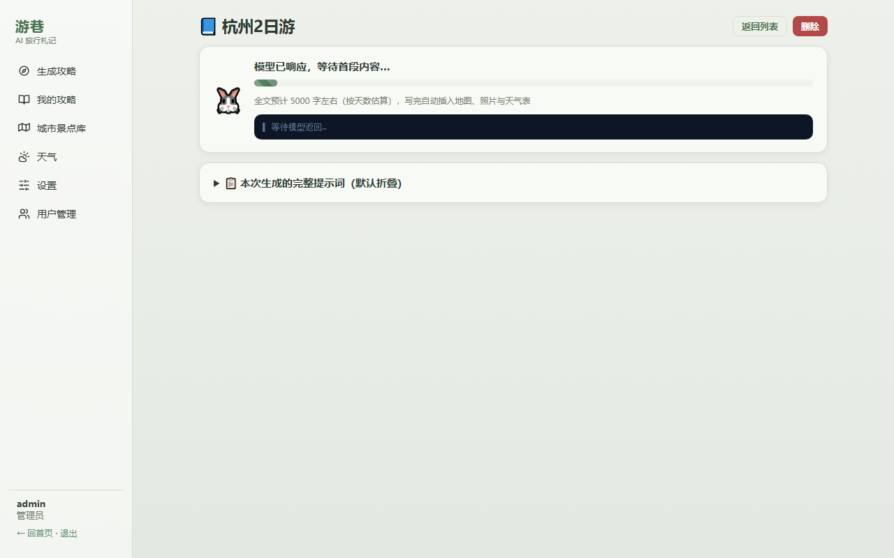
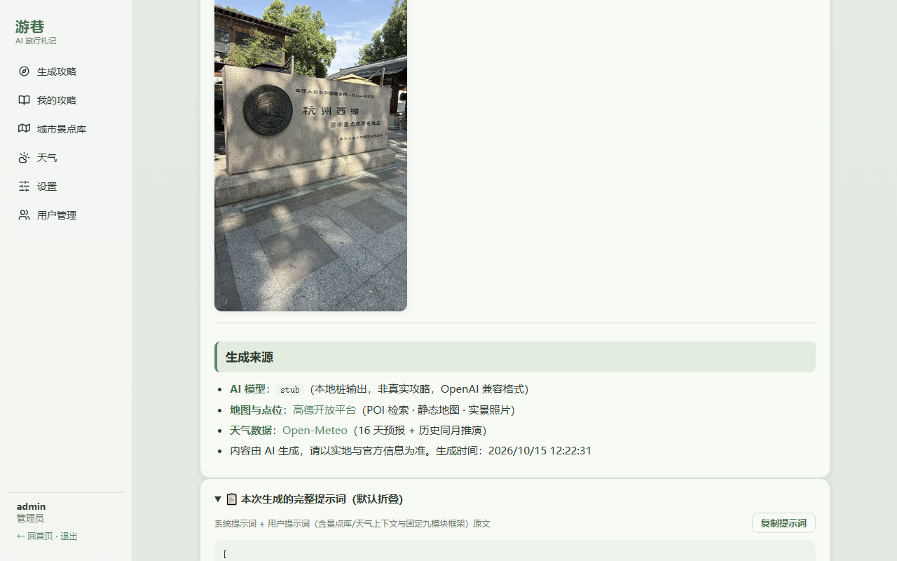
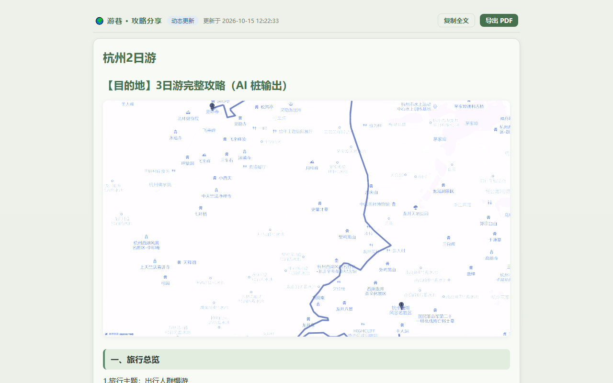

# 游巷 Alleyu

自托管的 AI 旅行攻略生成器：填一张表单，出一篇带地图、照片、天气推演的九模块攻略。多用户、多权限，支持分享链接（动态/静态）与 PDF 导出。








## 它能干什么

- **攻略生成**：按固定九模块框架输出（旅行总览 / 交通指南 / 住宿建议 / 每日详细行程 / 美食清单 / 门票&预约提醒 / 行前准备清单 / 避坑&安全贴士 / 可选拓展），信息落地、不走回头路。生成过程 SSE 流式可见，**进度条 + 阶段说明词 + 3 行实时内容小窗**（进度条下面直接看模型正在返回的正文尾巴，不猜），AI 返回空内容或明显过短（按天数定字数下限）时服务端自动重试 3 次，不再把红字错误甩给用户；失败/不满意的攻略在「复制全文」旁有**重新生成**按钮，原参数原地重跑。生成请求默认**关闭思考链**（`thinking: disabled`）：推理型模型（如 deepseek-flash）会把 max_tokens 预算全吃进思考链导致正文极短甚至为空，实测关掉才稳。
- **提示词透明**：每次生成的完整提示词（系统+用户，含景点库/天气上下文）落在攻略最下方「生成来源」之下的默认折叠框里，展开可看全文、一键复制——到底发了什么给模型，交代得清清楚楚。
- **分享链接（v1.6.0）**：攻略页「分享」按钮生成免登录可开的能力链接（32hex token，可撤销）——**动态更新**（你编辑/重新生成攻略，链接内容自动跟随）或**静态快照**（冻结当前内容，之后可手动「刷新快照」）。分享页整页排版、带模式徽标与更新时间，公开接口只回标题/模式/正文/时间，参数与提示词永不出服务端。删攻略自动清掉它的所有分享。
- **编辑与导出**：已完成攻略点「编辑」直接改 Markdown 原文（保存即更新，动态链接跟随）；「导出PDF」在**服务端生成 PDF 文件直接下载**（不弹打印对话框），带封面标题、章节、表格排版和页脚页码，攻略页和分享页都能导（分享页免登录同理）。服务器没找到中文字体时才回落浏览器打印，并把原因说明白。
- **图文并茂**：封面=**偏蓝单色**全程路线地图（全部点位按行程顺序编号、路线连接线串起来，显示层 CSS 压成蓝调、不用随机网图）、总览地图同样带全程连接线、每日驾车路线图、景点实景照片自动插入正文，图不够的地方文字补。**地图视野自适应**：按全部点位+连线的包围盒算缩放（高德静态图没有自动 fit），散开的景点不再被裁出框，尺幅 1000×580。
- **来源交代**：每篇攻略末尾自动附「生成来源」段——AI 模型与接口出处、地图/天气数据来源链接、生成时间；景点介绍引用了维基系条目时附来源致谢（CC BY-SA 4.0）；增强插图失败也照附。
- **天气**：未来 16 天逐日预报 + 近 5 年同月历史统计推演，附规则研判的出行提醒（非官方预警，页面明确标注）。
- **城市 / 景点库**：42 座国内种子城市 + **国际五线**（欧洲 / 中亚 / 东亚 / 北美 / 南美，58 座关键城市与著名景点直接入库，城市挑选对齐参考站 tabiji.ai 的目的地覆盖）。**线路不是写死的**（v1.7.0）：想加「中东线」「非洲线」直接在城市编辑里填新线路名，入库即在两处筛选里出现，城市可随时改挂别的线路。库页景点页签**先选线路再选城市、不选城市=全部景点分页浏览**（默认每页 10 条，10/20/30/50 可切，可前后翻页、按名字搜）。国内景点坐标缺失时自动用高德补齐，管理员可批量从高德 POI 导入。
- **景点介绍补全（v1.7.0）**：景点库每条景点可带**介绍文本**（来源=维基旅行 zh.wikivoyage.org，兜底维基百科，MediaWiki API 免 Key、800 字内节选）；管理员「⚡ 一键补全本城市」= 高德「风景名胜」分类检索批量导入（国内，两页 50 条去重留新）+ 全市缺介绍的景点逐条补维基介绍（上限 40 条/次）；国际线城市没有高德数据，只补介绍。补好的介绍两处生效：景点表格直接看，**生成攻略时进 AI 上下文**（写作时直接引用）；有引用的攻略末尾「生成来源」段自动附**致谢与 CC BY-SA 4.0 署名**。单条景点也有「介」按钮单独补。
- **多租户多权限**：管理员配全站唯一一份全局 AI Key、按人开通 `can_use_ai`、按人收窄可见页面（v1.6.0 起个人 Key 配置下线——两份配置分不清谁的锅）。Key 保存时自动剥掉全部空白字符；裸 32 位十六进制（丢了 `sk-` 前缀）的 Key 测连通 401 时会直接提示「像是粘贴时丢了开头」——服务商报错只回 `****a9f1` 尾巴，人眼根本看不出前缀丢了。
- **首页封面**：乳白小兔骑车动画（粉内耳+小黄帽），打一个字跳一下（兔跳特技），场景无天空、直接融入页面背景；侧栏菜单为单色线性图标（跟随文字色），favicon 与生成转圈也是兔子。

## 快速开始

要求 Node ≥ 22.5（用了 `node:sqlite`）。

```bash
npm install            # Windows 慢就加 --registry=https://registry.npmmirror.com
npm start              # 或双击 start.bat；默认 9610 端口
```

打开 http://localhost:9610，默认账号 `admin / admin123`（**部署后立刻改密码**）。

Docker：

```bash
docker compose up -d
```

前端构建产物已随仓库分发（`web/dist/<时间戳>/`，`.latest` 指当前版），clone 即用；改前端才需要重新构建（见下）。

## 配置

| 环境变量 | 默认 | 说明 |
|---|---|---|
| `PORT` | 9610 | 监听端口 |
| `DATA_DIR` | 项目下 `data/` | 数据库、密钥、地图图片缓存都在这 |
| `DEFAULT_ADMIN` / `DEFAULT_ADMIN_PASSWORD` | admin / admin123 | 仅空库首次启动生效 |
| `ALLEYU_AI_STUB` | — | 历史开关，现在只影响设置页显示标记。桩 AI 是「未配置任何 Key 时的兜底」：个人或全局配了 Key 一律走真接口，不会被它盖掉 |
| `ALLEYU_AI_FORCE_STUB` | — | **测试用真强制桩**：无视一切已配 Key 强制走本地桩（render 自检靠它拿到确定性；日常运行别开） |
| `ALLEYU_PDF_FONT` | 自动探测 | PDF 导出的中文字体绝对路径（单文件 .ttf/.otf；探测顺序=data/fonts/ → Windows 等线/黑体 → Linux 思源黑体；**.ttc 集合不支持**） |
| `ALLEYU_WIKI_OFFLINE` | — | 置 1 时维基介绍抓取直接报错（离线自检防偷跑真网用；日常运行别开） |

运行后配置（界面「设置」页）：

- **AI（管理员全局，全站唯一一份）**：OpenAI 兼容 `base_url + model + key`，开通 `can_use_ai` 的用户都用它。Key 落库前 AES-256-GCM 加密、自动剥掉粘贴带进的空白；接口只回 `has_key` 布尔，永不明文出服务端。
- **高德 Key**：自备——到 lbs.amap.com 申请**「Web服务」类型**的 Key（免费），部署后在「设置」页填入保存。「Web端(JS API)」类型调不了 REST 接口（infocode 10009）。Key 只在服务端使用，不下发浏览器。先点「测试连通」，报错会给人话原因（配额/IP 白名单/类型不匹配）。v1.6.3 起不内置任何默认 Key。

## 架构

```
server/                 Express + node:sqlite（单库，guides 按 user_id 隔离）
  auth.js               会话、页面权限白名单（allowed_pages 空=全开）
  crypto.js             AES-256-GCM（enc:v1:iv:tag:data），密钥在 data/.secret
  routes/               auth/users/ai/city/guide/share/amap/weather/settings 九组
  services/
    aiService.js        全局 Key 解析（v1.6.0 起全站唯一一份）、SSE 流式对话、桩模式
    pdfService.js       v1.6.1 服务端 PDF（中文字体探测 + marked→pdfkit 排版）
    guideService.js     九模块框架模板、生成主流程、插图管线
    amapService.js      POI 检索/地理编码/静态地图，全局 350ms 串行节流
    wikiService.js      维基旅行→维基百科介绍抓取（MediaWiki API 免 Key，200ms 串行节流）
    weatherService.js   Open-Meteo 预报+历史归档，免 Key
web/                    Vue 3 + Vite（hash 路由）+ marked
  src/views/            首页(兔子场景)/表单/攻略/历史/城市景点库/天气/设置/用户管理/分享页
  src/md.js             markdown 展示清洗（攻略页与分享页共用）
  dist/<时间戳>/         构建产物随仓库分发，.latest 标记当前版
scripts/
  check-alleyu.mjs      API 自检（--online 加真实外网断言）
  render-alleyu.mjs     Playwright 渲染自检 + 截图
```

几个值得知道的设计决定：

- **SSE 是查库不是转发的**：生成写库（节流 ~600ms），`GET /guides/:id/stream` 每 400ms 轮询推送。内容协议是「基线快照式」：正文追加推 `delta` 增量，内容被改写（配图阶段会在顶部前插封面地图）或断线重连则推 `reset` 全文快照——不会丢封面也不会重复中段。阶段变化推 `stage` 事件（进度条数据源）。
- **分享是能力链接不是会话**：`shares` 表存 32hex token（`crypto.randomBytes(16)`），公开读端点 `GET /api/share/:token` 在鉴权中间件的 EXEMPT 名单里（免登录），但响应只有 title/mode/content/updated_at 四个字段——prompt、params、images 元数据永不下发。动态模式每次打开现读攻略原文（攻略被删或正在重生成时返回 404 提示「稍后再试」），静态模式读创建/刷新时的快照。SQLite 默认不强制外键，删攻略时代码里手动清 shares。
- **图片管线**：静态地图 PNG 按 sha1 缓存在 `data/mapimg/`，免登录直链 `/api/amap/mapimg/<key>.png`；景点照片走 `/api/amap/photo?u=` 代理，域名白名单只有高德系。每个插图步骤独立 try/catch，图挂了文字攻略不受影响。点位识别以城市景点库为主；**库外城市（如青岛）自动用高德「景点」检索兜底当库**（真名+坐标+照片一次到位，必去景点优先，前缀模糊匹配正文短名）。静态地图 markers 上限 9 个（超出高德报 20003）。
- **攻略私有**：guides 只归本人，管理员也读不到别人的（用户管理页能看到的只有账号信息）；编辑、分享管理同样仅本人。
- **城市/景点库是全局共享的**：所有用户共用一份库，普通用户可以补录景点与介绍（删除/批量导入/一键补全仅管理员）；维基介绍带着 `intro_source`/`intro_url` 落库——CC BY-SA 署名跟随文本，手改介绍默认沿用原条目来源。

## 重新构建前端

```bash
cd web && npm install && npm run build
```

产物进 `web/dist/<新时间戳>/` 并更新 `.latest`，服务端下次请求自动用新版。

## 自检

```bash
node scripts/check-alleyu.mjs            # 离线桩模式，145 项（含 SSE 直播流/分享/编辑/PDF 导出/景点分页/动态线路全链路），起独立临时数据目录，不碰真实数据
node scripts/check-alleyu.mjs --online   # 追加 4 项真实外网（高德 POI / Key 连通测试 / Open-Meteo），消耗少量配额
node scripts/render-alleyu.mjs           # 渲染+截图，自起确定性桩服务器（独占 9610；设 ALLEYU_URL 可打外部已运行服务；playwright 已是 devDependency，clone 后 npm install 即可用）
```

## 诚实的边界

- 天气「预警」是**规则研判**（对预报/历史统计跑阈值），不是气象台官方预警，页面写明了。
- 历史天气是多年同月**统计推演**，用来判断"3 月去昆明大概什么温度"，不是气候保证。
- 高德免费 Key 3 QPS：一篇多日攻略的配图（地图+照片十几次调用）串行下来要半分钟上下，插图在正文之后异步补，等图是正常的。
- 生成进度条的百分比是**诚实估算**不是精确值：写正文阶段按「已生成字数 / 按天数估的字数」走，其余阶段到位即定格、斜纹动画表示进行中；没到 100% 是设计（配图串行耗时不定），不是卡住。
- 封面地图的「偏蓝单色」是显示层做的：存的是蓝墨标记+连线的静态图，前端 CSS `sepia+hue-rotate` 压成蓝调（不是黑白），不做服务端图像处理；路线连接线优先真实驾车路线，高德失败时退化为点位直连折线（保证一定有线）。地图缩放由 `mapFit.fitView` 按包围盒纯函数计算（Web 墨卡托米/像素换算），视野不足时宁可缩到城市级也不裁点。
- **国际线路没有地图配图**：高德静态地图实测没有海外底图（缩到世界级也只渲染中国区域），所以国际线攻略不插路线图与实景照片、正文会注明一行；天气推演（Open-Meteo 全球可用）与文字攻略、生成来源页脚照常。国际景点门票为「约」参考值，库页可改。同理**高德没有海外 POI**——国际线城市的「一键补全」只补维基介绍，不导景点。
- **维基介绍有就有、没有就没有**：抓的是维基旅行/维基百科对应条目首段节选（≤800 字），小众景点没条目返回 miss（不算错误）；介绍文本是**写作参考**不是权威导览，署名与条目链接存在景点库里，攻略引用了就附 CC BY-SA 致谢。维基是境外站点，网络不通时补全会把失败原因写在结果里，不炸。
- 没配 AI Key 时走本地桩（模板造的假数据，只用来验证管线，别拿它出行）；配了 Key 一律走真接口。旧攻略里残留的桩提示横幅在展示时会自动剥掉，正文只从第一个框架标题开始显示——AI 废话前言不展示、复制也不带走。
- **导出 PDF 需要服务器上有中文字体**（pdfkit 单文件 .ttf/.otf 渲染，**.ttc 集合不支持**——Windows 自动用系统等线/黑体，Docker/Linux 里请把任一中文 .ttf/.otf 放进 `data/fonts/` 或设 `ALLEYU_PDF_FONT` 指向绝对路径；没有字体时端点回 400，页面问一句后回落浏览器打印）。PDF 里的图片按原尺寸等比缩放进版心（仅 PNG/JPEG，外链 15s 超时、单图失败不拦整份），排版由 marked 词法树 + pdfkit 逐块绘制，不是浏览器截屏。复制全文按钮给的是 markdown 源码。
- **分享链接拿到即能看**：token 本身就是凭证（不带权限分级、不过期），撤销/删攻略才失效——别把链接发到不想要长久有效的地方，撤销后重新生成一个就是。
